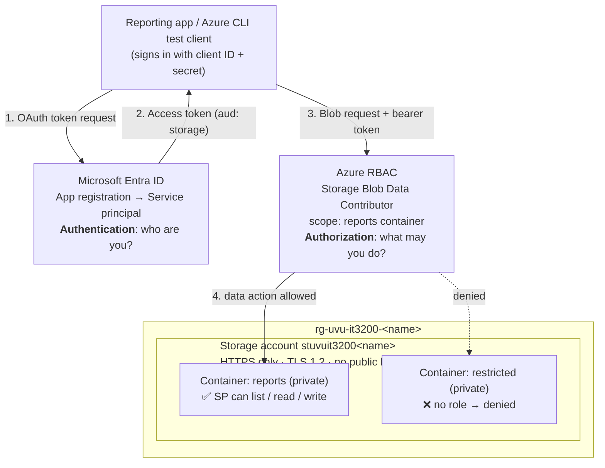

# M9 — Azure Blob Storage with a Service Principal and Least-Privilege RBAC

IT 3200 Cloud Computing · Utah Valley University · Fall 2026

A reporting application needs to upload and download files in Azure Blob Storage **without** a personal account, **without** storage account keys, and **without** broad admin rights. This repo deploys that environment with Terraform and includes scripts that prove what the application identity can and cannot do.

## Architecture



| Terraform resource | Purpose |
|---|---|
| `azurerm_resource_group.this` | Holds everything for this assignment; one `destroy` removes it all |
| `azurerm_storage_account.this` | StorageV2, LRS, HTTPS only, TLS 1.2, anonymous access off, shared-key auth off |
| `azurerm_storage_container.app` | `reports` — the only container the app may use |
| `azurerm_storage_container.restricted` | `restricted` — no role assignment; used for the negative test |
| `azuread_application.reporting` | App registration: the app's definition and the owner of its credentials |
| `azuread_service_principal.reporting` | The app's identity in this tenant; RBAC roles are assigned to this object |
| `time_rotating.secret` + `azuread_application_password.reporting` | 30-day client secret that Terraform rotates |
| `azurerm_role_assignment.app_blob_contributor` | Storage Blob Data Contributor on the `reports` container only, toggled by `grant_blob_access` |

### App registration vs. service principal

The **app registration** (application object) is the global template for the app: its name, sign-in audience, and credentials. The **service principal** is the instance of that app inside a specific tenant; it's the object that signs in and the object that gets RBAC role assignments. One app registration can have service principals in many tenants. That's why the role assignment uses `service_principal_object_id`, while sign-in uses the `client_id` and a secret that belongs to the app registration.

## Security decisions

- **Data-plane role, not management-plane.** `Reader` and `Contributor` act on the storage account *resource* (the management plane) and do not by themselves let an identity read blob contents with Entra auth. `Storage Blob Data *` roles grant *data actions* on the blobs themselves.
- **Contributor, not Owner, not Reader.** The app must list, upload and download.
  - Storage Blob Data Reader: list/read only, can't upload — too little.
  - Storage Blob Data Contributor: read, write, list and delete blobs — fits.
  - Storage Blob Data Owner: Contributor plus managing POSIX ACLs / ownership on Data Lake Gen2 — more than needed.
- **Scope = one container.** The assignment sits on `…/blobServices/default/containers/reports`, so the same identity is denied on `restricted` and on everything else in the subscription.
- **No keys.** `shared_access_key_enabled = false` means account keys and key-signed SAS can't be used at all, even by someone who obtained them. All access goes through Entra ID and is logged against an identity.
- **Short-lived secret.** The secret expires after 30 days. Terraform state holds the secret in plain text, so state stays local and is gitignored.
- **Production would be different:** if the app ran in Azure, a managed identity would remove the secret entirely; from GitHub Actions or another cloud, workload identity federation would.

## Prerequisites

Everything runs in a Linux shell (developed in WSL2 Ubuntu).

```bash
# Terraform (HashiCorp apt repo)
wget -O- https://apt.releases.hashicorp.com/gpg | sudo gpg --dearmor -o /usr/share/keyrings/hashicorp-archive-keyring.gpg
echo "deb [arch=$(dpkg --print-architecture) signed-by=/usr/share/keyrings/hashicorp-archive-keyring.gpg] https://apt.releases.hashicorp.com $(lsb_release -cs) main" \
  | sudo tee /etc/apt/sources.list.d/hashicorp.list
sudo apt update && sudo apt install -y terraform

# Azure CLI
curl -sL https://aka.ms/InstallAzureCLIDeb | sudo bash
```

Your Azure account needs permission to create resources, register an Entra application, and create role assignments (Owner or User Access Administrator on the subscription).

## Deploy and test

```bash
# 1. Sign in as yourself (device code works best from WSL)
az login --use-device-code
az account show --query "{name:name, id:id, user:user.name}" -o table

# 2. Configure
cp terraform.tfvars.example terraform.tfvars
#    set subscription_id and student_name; leave grant_blob_access = false

# 3. Part 1 + 2: storage and identity, NO role assignment yet
terraform init
terraform plan -out tfplan
terraform apply tfplan
terraform output          # client_secret shows as (sensitive)

# 4. Part 3: authenticated but not authorized
./scripts/test-access.sh before

# 5. Part 4: grant least-privilege access
#    set grant_blob_access = true in terraform.tfvars
terraform apply
az role assignment list --assignee "$(terraform output -raw service_principal_object_id)" \
  --all --include-inherited -o table

# 6. Part 5: positive and negative tests (wait a few minutes for propagation)
./scripts/test-access.sh after
```

`test-access.sh` signs the service principal in to a separate Azure CLI profile (`.azure-sp/`), so your own session, which Terraform uses, is never replaced. Logs are written to `evidence/`.

## Bonus: break it, fix it

```bash
# Break: set grant_blob_access = false
terraform apply             # plan shows 1 to destroy: the role assignment
./scripts/test-access.sh after    # upload/list/download now denied (after propagation)

# Fix: set grant_blob_access = true
terraform apply
./scripts/test-access.sh after    # works again
```

Because the permission lives in code, any change to it shows up in `terraform plan` and in a pull request diff before it reaches production.

## Troubleshooting

| Symptom | Likely cause | Check |
|---|---|---|
| `No subscriptions found` on SP login | Expected: the SP has no subscription-level role | The script passes `--allow-no-subscriptions` |
| `AuthorizationPermissionMismatch` after granting | RBAC propagation, or the CLI is not using `--auth-mode login` | Wait 5–10 min; `az role assignment list --assignee <sp-object-id> --all` |
| `AuthorizationFailed` on `az storage account show` | Expected: no management-plane role | That's the negative test |
| `Insufficient privileges` creating the application | Tenant blocks app registrations for users | Document the error; ask the instructor / tenant admin |
| First apply fails with a 403 on a storage data-plane read | The provider reading account properties over the data plane without a data role | Apply once with `shared_access_key_enabled = true`, then set it back to `false` and apply again |

## Tear down

```bash
terraform destroy
rm -rf .azure-sp
```

This deletes the resource group, storage, role assignment, service principal and app registration.

## Repository hygiene

`.gitignore` excludes `*.tfstate`, `*.tfvars`, `.terraform/`, the SP's CLI profile and test logs. `.terraform.lock.hcl` is committed so provider versions are reproducible. Before submitting:

```bash
git status --ignored
git log --all --oneline -- '*.tfstate' '*.tfvars'   # should print nothing
```

## AI assistance

Claude (Anthropic) was used to draft the initial Terraform, the test script, and this README. Verification: `terraform validate` against azurerm 4.81 / azuread 3.10, checking the provider schema to confirm `storage_container.id` is the ARM ID used for the role scope, comparing role permissions against Microsoft's built-in role documentation, and running the before/after tests to confirm the expected allow and deny results.
